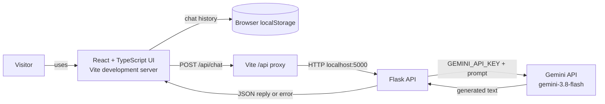
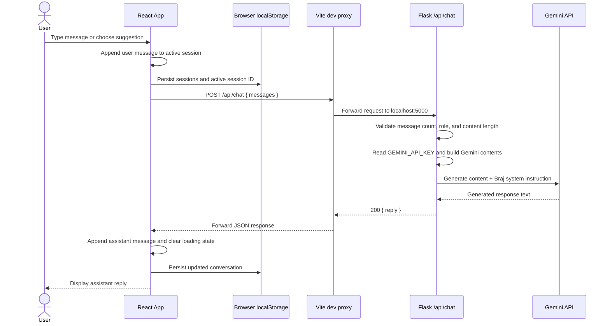

# Braj Travel Companion Architecture

This document describes the application as it is currently implemented: a React and TypeScript browser client, a Flask API, and Google's Gemini API.

## High-Level Architecture



### Responsibilities

| Part | Responsibility |
| --- | --- |
| React UI (`frontend/src/App.tsx`) | Renders the chat, suggested prompts, history, loading state, and errors; sends chat requests. |
| Browser `localStorage` | Persists chat sessions and the active session in this browser profile. It is not a server database or cross-device sync. |
| Vite (`frontend/vite.config.ts`) | Serves the development frontend and forwards `/api/*` requests to Flask. |
| Flask (`backend/app.py`) | Validates request data, reads the Gemini secret from backend environment, calls Gemini, and returns JSON. |
| Gemini API | Generates the travel assistant response from the conversation and system instructions. |

## Low-Level Request Flow



### Frontend State

- `sessions`: array of chat sessions; each session has an ID, title, and ordered messages.
- `activeId`: ID for the selected session.
- `draft`: current text in the composer; this is not sent until submitted.
- `busy`: prevents duplicate submissions and controls the typing indicator.
- `error`: displays an API or network error beside the composer.
- `menuOpen`: controls the responsive mobile navigation drawer.

Each message has a `role` (`user` or `assistant`) and text `content`. A new session starts with a client-side greeting; that greeting is not itself generated by Gemini.

### API Contract

`POST /api/chat`

Request:

```json
{
  "messages": [
    { "role": "assistant", "content": "Welcome message" },
    { "role": "user", "content": "Plan a day in Mathura" }
  ]
}
```

Successful response:

```json
{ "reply": "A generated travel-planning response" }
```

The backend accepts 1-20 messages. Each message must use `user` or `assistant` as its role and contain 1-4,000 characters. Invalid requests return `400`; missing `GEMINI_API_KEY` returns `503`; provider failures or empty responses return `502`.

`GET /api/health` returns `{ "status": "ok" }`. It confirms Flask is running but does not test Gemini credentials or availability.

## Configuration and Trust Boundaries

- `GEMINI_API_KEY` is read from `backend/.env` by Flask. It must never be placed in frontend code or committed.
- `GEMINI_MODEL` optionally overrides the default model, `gemini-3.8-flash`.
- `FRONTEND_ORIGIN` configures Flask CORS. During local development, browser API requests use the Vite proxy instead.
- `VITE_API_BASE_URL` is an optional frontend build-time setting. It defaults to same-origin `/api` locally; production sets it to the public Flask API base URL.
- The frontend origin is not trusted with the Gemini secret. The browser sends conversation text to Flask; Flask authenticates with Gemini.
- Chat data is sent to Google's Gemini API when a user submits a message. Do not send sensitive personal information in chat.
- The Vite proxy is for local development. The Render production setup uses a static frontend with `VITE_API_BASE_URL` pointing to the public Flask service, and `FRONTEND_ORIGIN` set to the frontend origin. The Gemini key is configured as a Render backend secret.

## Local Services

| Service | Local address | Start command from its directory |
| --- | --- | --- |
| Flask API | `http://127.0.0.1:5000` | `../backend/.venv/bin/python app.py` from `backend/` can be run as `.venv/bin/python app.py`. |
| Vite frontend | `http://localhost:5173` | `npm run dev` from `frontend/`. |

The frontend talks to Flask through Vite's `/api` proxy, so both development services must be running for chat requests to work.

## Production Topology

GitHub Actions checks the frontend and backend on pull requests and pushes to `main`. Render's Blueprint waits for these checks before deploying its free static site and Flask web service. See [DEPLOYMENT.md](DEPLOYMENT.md) for free-tier caveats and setup steps.