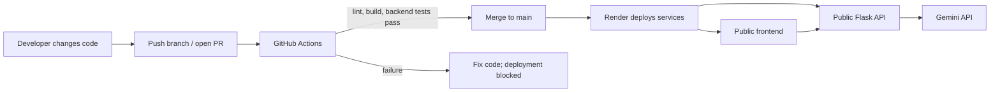

# Free Hosting and CI/CD

<!-- Temporary branch-protection workflow check. -->

This project is prepared for a GitHub + Render deployment. A GitHub account and a Render account are needed to publish it; this repository has not been pushed to GitHub and no public site has been created yet.

## What CI/CD Means

- **CI (Continuous Integration):** GitHub Actions automatically checks every pull request and push to `main`. It installs the project dependencies, runs frontend lint/build, and runs backend tests. The checks catch common mistakes before they reach the public app.
- **CD (Continuous Deployment):** Render watches the connected GitHub branch. The Blueprint uses `autoDeployTrigger: checksPass`, so Render waits for GitHub checks to pass before deploying. A failed check blocks that deploy.



## Free Hosting Layout

- **Frontend:** Render Static Site, served through its CDN. Static sites are free and remain responsive while the backend may be asleep.
- **Backend:** Render Free Web Service running Flask + Gunicorn. It sends chat requests to Gemini and keeps `GEMINI_API_KEY` server-side.
- **Source and CI:** GitHub repository and GitHub Actions.

### Important free-tier limits

Render Free web services sleep after 15 minutes with no inbound traffic; the next request can take about a minute while the service starts. Free service files are ephemeral and there is no persistent disk. Chat history in this project is browser `localStorage`, so it stays in that browser but is not backed up or synced across devices. Render's free PostgreSQL option is not used; Render currently documents a 30-day expiration for free Postgres databases. Gemini free-tier quotas and data terms are separate and may change. This setup is suitable for a learning/demo project, not a reliability guarantee for production.

## Before Deploying

1. **Keep the key private.** `backend/.env` is local and ignored by Git. Never add a real Gemini key to GitHub, `render.yaml`, frontend code, or a screenshot. Render will ask for `GEMINI_API_KEY` during Blueprint creation because it is marked `sync: false`.
2. **Create a GitHub repository.** Create an empty repository on GitHub, then run these commands from the local project root, replacing the URL with your new repository's URL:

    ```sh
    git status --short
    git check-ignore backend/.env
    git add .
    git status --short
    git commit -m "Prepare Braj travel chatbot for hosting"
    git remote add origin https://github.com/YOUR-ACCOUNT/YOUR-REPOSITORY.git
    git push -u origin main
    ```

    Before committing, confirm `backend/.env` is ignored and does not appear in the staged-file list. Do not stage `.venv/`, `node_modules/`, or frontend `dist/` either; `.gitignore` excludes them.
3. **Push `main`.** The workflow runs on pull requests and pushes to `main`. Confirm both CI jobs pass in the GitHub Actions tab before deployment.
4. **Create the Render services from the Blueprint.** In Render, choose **New > Blueprint**, connect the GitHub repository, and deploy the root `render.yaml`. Enter the Gemini API key in Render's secret prompt, not in the YAML file.
5. **Check service names and URLs.** The Blueprint expects these URLs:
   - Frontend: `https://braj-chatbot.onrender.com`
   - API: `https://braj-chatbot-api.onrender.com`

   Render service names/subdomains must be available. If Render requires different names or gives different URLs, update both linked settings: backend `FRONTEND_ORIGIN` must equal the exact frontend origin, and frontend `VITE_API_BASE_URL` must equal the API base URL (no trailing slash). Then redeploy the frontend and backend.
6. **Verify the live deployment.** Visit `<API base URL>/api/health`; expect `{"status":"ok"}`. Open the frontend URL and send a short test chat. This makes a real Gemini API request, so Gemini quota/usage applies.

## CI/CD in Daily Use

1. Make a small code change on a feature branch.
2. Push the branch and open a pull request to `main`.
3. GitHub Actions runs frontend lint/build and backend tests. Fix any failed check before merging.
4. Merge the passing pull request into `main`.
5. Render sees the new commit, checks GitHub Actions, then builds and deploys the updated services. Watch each service's Events/Logs in Render if a deploy fails.

## Useful Local Checks

From `frontend/`:

```sh
npm ci
npm run lint
npm run build
```

From `backend/` with the project virtual environment active:

```sh
python -m unittest discover -s tests -v
```
